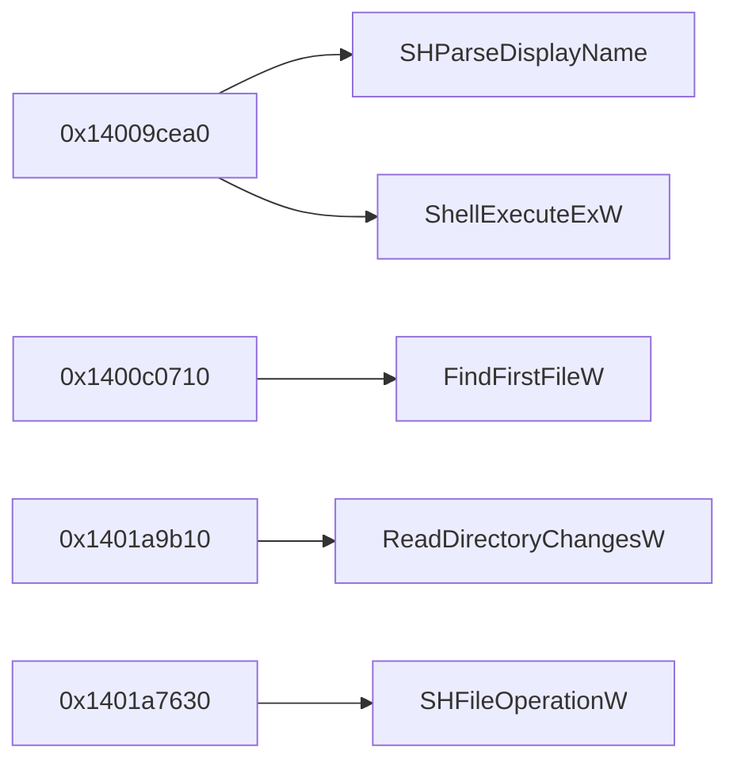

# RE-01 — Explorer++ 바이너리 구조

분석 대상은 공식 x64 배포 실행파일 Explorer++ **1.4.0.2293**이다. 파일 크기는 **4,100,096 bytes**, SHA-256은 `22ac20341c5525658ebe5e9c4b9ac9f7c152b18080ff347861fac3f04d56a2d6`이다. 다운로드 URL·배포 archive 해시·출처 한계는 [target-manifest.json](target-manifest.json)에 보존했다. 이 문서 작성 과정에서 원본 C++ 소스는 열람하지 않았다.

## 근거의 구분

| 근거 | 성격 및 범위 |
|---|---|
| [explorer-overview.json](evidence/explorer-overview.json) | 실제 REA `binary_overview` 결과. Ghidra 12.1.4의 메모리 블록·함수·정의 문자열 inventory에서 도출한 요약. Evidence `ev_06f64e95abe9b0a2e1e7800f10c185a19968a86b99cd487f23cded461f0aabfd`. |
| [phase2-initial-bundle.json](evidence/phase2-initial-bundle.json) | 최초 정적 조사 REA 원본 Evidence bundle. 도구·매개변수·provider·프로파일·대상 해시·결과·제약을 보존한다. |
| [phase2-static-bundle.json](evidence/phase2-static-bundle.json) | 추가 정적 조사 REA Evidence. 리소스 트리와 주요 함수의 의사코드·호출 관계를 포함한다. |
| [pe-inventory.json](evidence/pe-inventory.json) | [inspect_pe.py](../../scripts/inspect_pe.py)가 실행파일 바이트를 직접 해석한 **보충 자료**. REA 도구 출력이나 REA Evidence가 아니다. 헤더·섹션·ordinary import·export의 원시 위치와 SHA-256을 보존한다. |

PE 구조 해석에는 [Microsoft PE Format 문서](https://learn.microsoft.com/en-us/windows/win32/debug/pe-format)를 참고했다. 이 문서에서 주소는 별도 표시가 없으면 **선호 image base 기준 VA**이며 실행 중 프로세스 주소를 측정한 값이 아니다. Import 항목의 존재만으로 해당 API의 실행 또는 특정 기능 구현을 입증하지 않는다.

## 형식과 헤더

보충 바이트 파서가 확인한 값:

| 항목 | 값 |
|---|---|
| DOS / PE signature | `MZ` / `PE\0\0` |
| PE signature 파일 offset | `0x128` |
| COFF machine / optional magic | `0x8664` (x64) / `0x20b` (PE32+) |
| 섹션 수 / optional-header 크기 | `7` / `240 bytes` |
| Image base | `0x140000000` |
| Section / file alignment | `0x1000` / `0x200` |
| SizeOfImage / SizeOfHeaders | `0x3f8000` / `0x400` |
| Subsystem | `2` (Windows GUI) |
| COFF characteristics / DLL characteristics | `0x22` / `0x8160` |
| COFF symbol table / symbol count | `0` / `0` |
| Timestamp 원시 정수 | `1706454147`; 독립적인 빌드 시점 입증으로 취급하지 않음 |
| Certificate / delay-import / CLR directory | 각각 RVA 또는 file offset `0`, size `0` |

아키텍처와 image base는 REA 관찰과 일치한다. 디렉터리 부재는 해당 PE directory가 선언되지 않았다는 뜻이다. 동적 로딩, 패킹 또는 모든 런타임 의존성의 부재까지 입증하지 않는다. 전체 optional-header 필드와 각 data directory의 위치·범위는 보충 JSON에 있다.

## 섹션과 진입점

| 섹션 | RVA | VirtualSize | 파일 offset | RawSize | 특성 |
|---|---:|---:|---:|---:|---|
| `.text` | `0x1000` | `0x2b0d3e` | `0x400` | `0x2b0e00` | 읽기·실행 |
| `.rdata` | `0x2b2000` | `0x9bcc4` | `0x2b1200` | `0x9be00` | 읽기 |
| `.data` | `0x34e000` | `0x2b67c` | `0x34d000` | `0x1fa00` | 읽기·쓰기 |
| `.pdata` | `0x37a000` | `0x1dd6c` | `0x36ca00` | `0x1de00` | 읽기 |
| `_RDATA` | `0x398000` | `0xf4` | `0x38a800` | `0x200` | 읽기 |
| `.rsrc` | `0x399000` | `0x59928` | `0x38aa00` | `0x59a00` | 읽기 |
| `.reloc` | `0x3f3000` | `0x4a44` | `0x3e4400` | `0x4c00` | 읽기·discardable |

각 섹션의 시작 VA와 `max(VirtualSize, RawSize)` 범위는 REA overview의 일곱 대응 메모리 블록과 모두 일치했다. REA가 보고한 **9개 블록**에는 `Headers`와 `tdb`도 포함되므로 이를 PE 섹션 9개라고 해석하지 않는다. 특히 `tdb`는 PE 섹션 테이블에 없는 Ghidra 블록이다.

바이트 헤더의 AddressOfEntryPoint는 RVA **`0x223524`**, 선호 VA **`0x140223524`**, `.text` 내부 파일 offset **`0x222924`**이다. REA `search_procedures`의 `entry` 주소와 일치한다(Evidence `ev_5f4b741ad2d49219be87ae4178436805dc515ae8db896794396f01b453a7f6de`). 진입점은 사용자 폴더 탐색 로직의 시작점으로 확인된 것이 아니다.

## Import / Export

보충 파서는 ordinary import descriptor와 각 64-bit lookup thunk의 null terminator까지 조사했다. **22개 DLL, 519개 항목**이며 이름 기반 **494개**, ordinal 기반 **25개**이다. DLL 이름의 대소문자와 ordinal 원본을 유지했고, ordinal을 이름으로 추정해서 대체하지 않았다.

| DLL | 항목 수 | DLL | 항목 수 |
|---|---:|---|---:|
| `SHELL32.dll` | 30 | `gdiplus.dll` | 38 |
| `SHLWAPI.dll` | 25 | `MPR.dll` | 1 |
| `UxTheme.dll` | 4 | `WINMM.dll` | 1 |
| `urlmon.dll` | 1 | `WININET.dll` | 1 |
| `PROPSYS.dll` | 1 | `dwmapi.dll` | 4 |
| `KERNEL32.dll` | 203 | `USER32.dll` | 125 |
| `GDI32.dll` | 23 | `WINSPOOL.DRV` | 3 |
| `ADVAPI32.dll` | 16 | `ole32.dll` | 22 |
| `OLEAUT32.dll` | 10 | `IPHLPAPI.DLL` | 1 |
| `USERENV.dll` | 1 | `COMCTL32.dll` | 5 |
| `VERSION.dll` | 3 | `COMDLG32.dll` | 1 |

조사에 유용한 정적 의존성 예시는 `FindFirstFileW`/`FindNextFileW`, `ReadDirectoryChangesW`, `SHParseDisplayName`, `SHGetFileInfoW`, `ShellExecuteExW`, `SHFileOperationW`, `RegisterDragDrop`/`DoDragDrop`, `StrCmpLogicalW`이다. 이들은 탐색·변경 감지·Shell·정렬 조사 후보를 제공한다. 실제 호출 위치에 대한 근거는 아래 REA 기록으로 별도 구분한다.

**Export directory는 존재한다.** RVA `0x34a0f0`, 크기 `0x300`, ordinal base `1`이며 이름이 있는 6개 항목이다. 모든 원시 decorated name을 JSON에 보존했다. 이름에는 `cereal`, `PolymorphicCasters`, `StaticObject`가 포함된다. 바이트에서 읽힌 이름이라는 관찰을 넘어 라이브러리 버전이나 구체적 기능을 확정하지 않는다.

| Ordinal | 대상 RVA | 대상 섹션 | 비고 |
|---:|---:|---|---|
| 1 | `0x377e58` | `.data` | 파일에 바이트가 없는 가상 데이터 영역 |
| 2 | `0x268e0` | `.text` | 실행 가능 섹션 |
| 3 | `0xdc930` | `.text` | 실행 가능 섹션 |
| 4 | `0xdc920` | `.text` | 실행 가능 섹션 |
| 5 | `0x377e60` | `.data` | 파일에 바이트가 없는 가상 데이터 영역 |
| 6 | `0x377e70` | `.data` | 파일에 바이트가 없는 가상 데이터 영역 |

따라서 export 6개를 함수 6개라고 세지 않는다. Forwarder 문자열은 이 여섯 항목에서 관찰되지 않았다. Export directory 자체가 없다는 결론은 이 대상의 바이트와 배치된다.

## 문자열·리소스·함수 inventory

실제 REA/Ghidra overview는 **함수 inventory 9,610개**, **정의된 문자열 Data 4,962개**를 보고했다. 함수 수는 REA `list_procedures`와 같은 local/external inventory 기준이다. 아직 식별하지 못한 함수까지 모두 발견했다는 의미가 아니다. 문자열 수도 Ghidra가 정의한 문자열 inventory의 수이며 모든 텍스트 바이트를 망라하지 않는다. 이름·문자열 검색 결과가 비어도 해당 기능 또는 문자열이 없다고 결론 내릴 수 없다.

실제 REA `search_strings`에서는 `folderSettings` (`0x1402d3720`), RTTI 형태의 `.?AVShellTreeView@@` (`0x14036ce20`) 등의 분석 단서를 확보했다(Evidence `ev_d7026ef387782a21957e238eaa5bd192e30cb54e8d8b0567f51193bb18af7432`). 이 문자열만으로 설정 저장 방식 또는 트리 동작을 입증하지 않는다.

실제 REA `inspect_pe_resources`는 **847개 entry를 검사해 418개 resource, 2개 icon group**을 보고했다. Provider는 Ghidra가 아닌 **REA PE resource parser 1**이며 Evidence는 `ev_973ef9b5b6459cac03f85af8ad721e361ac1b973977135ea70b348e80f98df73`이다. 이 범위에서 resource-tree coverage는 `complete`이다. 관찰된 type/name 값별 수는 다음과 같다.

| Type/name 원본 | 수 | Type/name 원본 | 수 |
|---|---:|---|---:|
| `AFX_DIALOG_LAYOUT` | 10 | `PNG` | 296 |
| `WAVE` | 1 | ID `2` | 3 |
| ID `3` | 4 | ID `4` | 16 |
| ID `5` | 27 | ID `6` | 55 |
| ID `9` | 1 | ID `14` | 2 |
| ID `16` | 1 | ID `24` | 2 |

리소스의 type/name/language, 위치, payload SHA-256 및 icon group 관계는 원본 Evidence에 보존되어 있다. `RT_GROUP_ICON` 외 payload는 opaque이다. 실제 PNG/문자열/메뉴/대화상자 디코딩, 언어 fallback, UI 또는 Shell이 어느 리소스를 로드하는지는 관찰하지 않았다. UI 자산을 재구현에 추출·포함하지 않았다.

## REA가 확인한 정적 호출 관계

| 질문 | 실제 REA 관찰 | Evidence |
|---|---|---|
| 파일 열기 후보 | `ShellExecuteExW`의 호출자 `0x14009cea0`, `0x1400bd5c0`, `0x140194fd0` | `ev_44f502515c8685c94a77584c61cbe69d3ecde42f0f2dda46c57219a7f4f7d153` |
| 경로의 Shell 해석 후보 | `SHParseDisplayName` 호출자 27개; 예: `0x14009cea0`, `0x140172860` | `ev_7bc52a97a76a9a7002abf0c4ad3c90814537187a57c85173b13345dcc444b779` |
| 디렉터리 열거 후보 | `FindFirstFileW` 호출자 13개; 예: `0x1400c0710`, `0x140172c10` | `ev_0dfa284fee6bdbe814300c762850d81edbddd3fc347ec15d4bca396c6e7c41b0` |
| 변경 감지 후보 | `ReadDirectoryChangesW` 호출자 `0x1401a9b10` 및 해당 의사코드 확보 | `ev_0c007d61edfd1c639376bedc0bbf7518323f027ae6e8582ac9c93c6da05ff466`, `ev_c575f01e0e8efd6219b1f6ecd377ea9f403a63d2f9acfde0d41b3e66545e711f` |
| 파일 작업 후보 | `SHFileOperationW` 호출자 `0x1401a7630` 및 해당 의사코드 확보 | `ev_b957a5780fddbffbadceb44e7c71fb93ecc8bafa17e4d97b9e57660520e24f6e`, `ev_a6af60e3bd61d7cca2e8d3255e23dbddbe9bcb8f3147c26c54e7dca7ae1a66e9` |



이는 Ghidra가 복원한 정적 호출의 일부이며 실행 추적이나 전체 호출 그래프가 아니다. UI 이벤트와의 대응 및 분기의 의미는 RE-02~RE-04의 개별 조사에서 확인해야 한다. 디컴파일 결과는 원본 소스가 아니다. PDB `Explorer++.pdb` 참조는 관찰되었으나 load state는 unknown이며, REA는 호출자 지정 PDB companion을 지원하지 않으므로 원래 함수명과 타입이 누락되었을 수 있다.

## 実行済み検証と残る範囲

実行コマンド:

```powershell
python scripts/inspect_pe.py artifacts/original/Explorer++.exe --manifest docs/analysis/target-manifest.json --output docs/analysis/evidence/pe-inventory.json
```

이 명령은 대상을 읽고 manifest의 크기·SHA-256 일치를 확인한 후 JSON을 저장했다. 별도 대조에서 대상 해시, image base, PE 섹션 7개 모두의 시작·범위, entry VA가 기존 REA Evidence와 일치했다. 입력 실행파일의 실행·변경은 수행하지 않았다. 파서는 파일 범위·섹션 중복·RVA 변환의 유일성·테이블 종결을 검사하며 입력 128 MiB, 열거 항목 65,536개, 문자열별 65,536 bytes 등의 한계를 적용한다. 실패 시 불완전한 inventory를 저장하지 않는다. Windows loader 적합성 전체를 검증하는 도구는 아니다.

RE-01에서 확보한 범위는 PE 구조, ordinary import/export 전체 표, Ghidra inventory 요약, 리소스 트리, 위 함수·호출 후보이다. 함수 9,610개와 문자열 4,962개의 전체 목록 자체를 이 보고서에 내보낸 것은 아니며, 전체 호출 그래프, 동적 로딩, 리소스 payload 내용과 실제 로딩, API별 실행 중 호출은 미검증이다. 이 한계를 개별 기능의 역공학 성공으로 취급하지 않는다.
