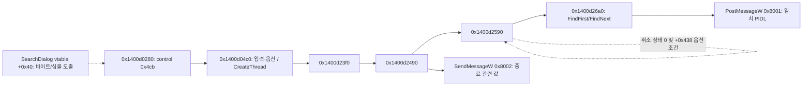

# RE-03·P0 — 기능 질문과 정적 근거 지도

대상은 Explorer++ **1.4.0.2293**, SHA-256 `22ac20341c5525658ebe5e9c4b9ac9f7c152b18080ff347861fac3f04d56a2d6`([manifest](target-manifest.json)). 실제 REA/Ghidra 12.1.4 [정적 bundle](evidence/phase2-static-bundle.json) **71기록, 38,872,790바이트**, [binary-overview.md](binary-overview.md), [file-navigation.md](file-navigation.md)를 기준으로 한다. 원본 소스는 읽지 않았다. 주소는 선호 VA이며 실행 추적 주소가 아니다.

아래 `관찰`은 주로 의사코드/심볼/바이트에서 실제 확보한 값이다. `도출`은 이 자료 사이의 관계 또는 SDK 인터페이스 배치 해석이다. `추론`은 구현 의도 가설이며 `미확인`은 직접 근거가 없는 부분이다. 원본 GUI 관찰은 별도 작업에서 시작 단계이므로 이 문서에서 잠정 스냅샷으로 이벤트 매핑을 확정하지 않는다. 재구현은 없고 **기능 구현·테스트 통과·역공학 전체 성공은 전부 미검증**이다.

## 추가 Evidence 색인

[file-navigation.md](file-navigation.md)의 BROWSE/ENUM/META/COMPARE/PARSE/NAMES 참조는 동일한 canonical Evidence를 가리킨다. 다음 식별자도 모두 정적 bundle 원본에서 직접 확인했다.

| 참조 | 실제 REA 도구·대상 | Evidence |
|---|---|---|
| OPEN-DISPATCH | `procedure_pseudo_code`, `0x1400bce20` | `ev_fc2e69129dd48e48cb15ae6d6d6d7a724a1e2e67dda942c84297943ce2bde8cf` |
| OPEN | `procedure_pseudo_code`, `0x1400bd5c0` | `ev_369e8cb0f86b0a7f29c9cff2149e791629aa707c191c9780fbd8754d0783694b` |
| OPEN-CALLERS | `procedure_callers`, `0x1400bce20` | `ev_0afb9884a651186b73acb2bd3a38660209b748b156e864a36caf07579c45d7e1` |
| SEARCH-VTABLE | `read_bytes`, `0x1402e19e0`, 168바이트 | `ev_ae2fe1c352f9575a7c6dd213a4fc95c525cb3eed73dcc29cdef028da1493c53a` |
| SEARCH-COMMAND | `procedure_pseudo_code`, `0x1400d0280` | `ev_e62a9ea2c70c21a4c3c64bcd43f12bb17fdaab6ebf7c34d5469753bf8751d56a` |
| SEARCH-START | `procedure_pseudo_code`, `0x1400d04c0` | `ev_db4a1bcf15da634cb92bf7b176fe59912ef93abe6dd6399870b961fd51995856` |
| SEARCH-THREAD | `analyze_function`, `0x1400d23f0` | `ev_186ca57c3ba8682e09cbc461075806eaaafffbcdc081f8997e7dead3522771df` |
| SEARCH-WORK | `procedure_pseudo_code`, `0x1400d2490` | `ev_6884eda4b24742b2232eb7b958dbf5baa41a979bca4d8695c6141190d055a83c` |
| SEARCH-RECURSE | `procedure_pseudo_code`, `0x1400d2590` | `ev_0551af17abc1dd9d36c43496a11b0b0a0ea3764d5ee54f306e823eb779465c65` |
| SEARCH-ENUM | `procedure_pseudo_code`, `0x1400d26a0` | `ev_b4e0b8a1e8e4f42957490f2d0cd7a2580e22290d486c92dbbbe7384cc23eaada` |
| SEARCH-LIST | `procedure_pseudo_code`, `0x1400d2000` | `ev_284a9d8659356df0716d71c251dc79d2ae4e96f149abb6203cc73c9d4a94fa92` |
| CHANGE | `analyze_function`, `0x140171ba0` | `ev_1833fa2545dcaf1a16f796fe9e11fad0146e3cb7b969facef4aaa36ac1720255` |

원본 Evidence의 `confidence: observed`는 정적 표현의 관찰이며 UI 이벤트 도달이나 런타임 성공을 보증하지 않는다. SEARCH-THREAD의 resolved-call coverage는 `complete`지만 계산/간접 흐름 미해결 한계가 그대로 남는다. OPEN-CALLERS의 빈 결과도 가상 호출 가능성을 배제하지 않는다.

## 필수 7개 사용자 이벤트

| 이벤트 | 확보한 관찰·도출 | 미확인 범위와 다음 실제 확인 |
|---|---|---|
| 1. 폴더 더블클릭 | OPEN-DISPATCH는 PIDL의 Shell 속성/특수 위치를 검사하고 조건에 따라 `0x1400bd3e0`, 가상 slot `+0x70`, 또는 `ShellExecuteW`로 분기한다. BROWSE의 폴더 목록 파이프라인은 별도 확보했다. | 더블클릭 notification→선택 PIDL→dispatcher→browse의 연결은 없다. fixture 하위 폴더 더블클릭 전후 경로·목록·기록을 관찰하고 실제 이벤트 핸들러 참조를 좁힌다. 일반 파일 더블클릭과 폴더 동작도 구분한다. |
| 2. 상위 폴더 | OPEN의 `ILRemoveLastID`는 실행 working directory를 만들기 위한 부모 PIDL 처리이다. | 이것을 상위 버튼 핸들러로 오인하지 않는다. 상위 UI/단축키→부모 계산→browse, 드라이브 루트/가상 위치의 동작은 미확인이다. nested fixture와 루트에서 원본 관찰 후 caller/command를 조사한다. |
| 3. 뒤로·앞으로 | NAMES에 `NavigationController<HistoryEntry,long>`/`ShellNavigationController` vtable/RTTI가 있다. PARSE는 배열·현재 index 검증 후 서로 다른 객체의 가상 메서드를 선택한다. | 클래스 존재만으로 기록 갱신/뒤·앞 정책을 복원했다고 하지 않는다. A→B→C→뒤→다른 경로에서 forward 처리, 경계 비활성화·탭별 기록을 관찰하고 각 command와 history 상태 변경 함수를 확인한다. |
| 4. 새 탭 | NAMES에서 `TabContainer::vftable` (`0x1402e2318`)와 RTTI/콜백 단서를 관찰했다. | 새 탭 생성/복제·초기 경로·전환·닫기·최종 탭 정책의 handler와 상태 소유자는 미확인이다. 원본 메뉴/단축키/실제 탭 동작을 기록하고 command→TabContainer 경로를 추적한다. |
| 5. 파일 선택 | MATERIALIZE와 `0x14017cc30`에 ListView 상태·위치·선택 관련 보조 처리가 있다. | 이 함수들은 실제 사용자 선택 notification의 완전한 핸들러로 확인되지 않았다. 마우스 단일 선택·Ctrl/Shift·키보드 선택 후 표시/상태줄 변화를 관찰하고 notification→내부 선택 모델 경로를 조사한다. |
| 6. 파일 이름 변경 | NAMES에 `Starting in-place rename of item`, `MassRenameDialog`/`RenameTabDialog` 단서가 있고 CHANGE는 디렉터리 변경 처리 후보이다. | 파일 rename, 대량 rename, 탭 rename, 외부 이름 변경 알림을 구별해야 한다. 현재 evidence로 rename 실행 API·F2/label-edit 승인·충돌/권한 실패 경로를 확정할 수 없다. 별도 disposable fixture로 UI 동작을 관찰한 후 `SetNameOf`/파일작업 및 label-edit 참조를 조사한다. |
| 7. 검색 실행 | NAMES의 `SearchDialog::vftable`과 SEARCH-VTABLE을 결합하면 `+0x40`에 SEARCH-COMMAND가 있다. 이 함수의 control `0x4cb` 분기는 SEARCH-START를 호출한다. SEARCH-START는 입력/checkbox를 읽고 `CreateThread(…,0x1400d23f0,…)`를 사용한다. worker→재귀/열거/결과 메시지 경로가 실제 의사코드에 있다. | `0x4cb`와 실제 클릭/Enter·메뉴의 대응 및 대화상자 진입은 미검증이다. 현재 폴더/하위 폴더 선택, pattern·대소문자·regex·속성 필터·결과 수·취소/오류를 원본에서 확인해야 한다. 독립 SearchDialog를 현재 폴더 inline 검색과 동일하다고 취급하지 않는다. |

## 검색 내부 경로의 범위

SEARCH-START는 일부 조건에서 검색 문자열에 `*%s*`를 적용한다. SEARCH-ENUM은 `PathCombineW(path,"*")`, `FindFirstFileW`/`FindNextFileW`, `.`/`..` 제외, 이름/속성 필터, `SHParseDisplayName`/`ILClone`, `PostMessageW(...,0x8001,PIDL,0)`을 포함한다. SEARCH-RECURSE는 수집한 하위 경로에 대해 **취소 상태가 0이고 `+0x438` 옵션이 켜졌을 때만** 자신을 호출한다. 따라서 모든 검색이 재귀적이라는 주장은 틀리다. 옵션 필드의 실제 UI 명칭·default, 링크 순환·권한 실패·첫 항목 처리의 정확성은 미확인이다.

SEARCH-LIST는 대화상자 항목 `0x4ca`의 ListView에 메시지 `0x104d`를 보낸다. 결과 PIDL의 메시지 수신부터 이 함수까지의 전체 경로를 아직 연결하지 않았으므로 완전한 비동기 검색/결과 표시 복원 성공이라고 하지 않는다. thread argument·일부 helper 인수는 Ghidra가 생략하거나 추정하므로 원본 시그니처로 간주하지 않는다.

## P0 기능별 질문·현황

| 기능 | 분석 질문과 확보 근거 | 현 상태·추가 증거 |
|---|---|---|
| FR-01 기본 UI | 주소/트리/목록/탭/상태줄의 실제 구성과 이벤트 소유자는? NAMES의 `ShellBrowser`, `ShellTreeView`, `TabContainer`, ListView 메시지가 정적 단서다. | 부분 정적 근거. 원본 전체 창·구성요소·포커스/resize 관찰과 재구현은 미검증. |
| FR-02 폴더 탐색 | 드라이브/폴더에서 어떻게 자식 항목을 얻는가? BROWSE→ENUM→BIND, Shell 열거→META→QUEUE→MATERIALIZE 경로. | RE-02 부분 도출 확보. 드라이브·빈/대량/특수 위치 실행, 완전성·에러/성능·UI 진입은 미확인. |
| FR-03 경로 이동 | 직접 경로와 더블클릭이 같은 파이프라인으로 가는가? PARSE의 `SHParseDisplayName`, OPEN-DISPATCH 및 BROWSE는 별도로 확보. | 양쪽 UI 진입→내부 경로의 연결 불완전. 주소 Enter·폴더 더블클릭·잘못된 경로 원본 비교 필요. |
| FR-04 기록/상위 | history의 추가·index·분기·부모 이동 정책은? navigation RTTI/vtable와 PARSE 배열/index 분기가 단서. | 동작 복원 미완료. nested/분기/루트·탭별 기록 관찰 및 실제 command 경로 필요. |
| FR-05 파일 정보 | 표시 이름·크기·형식·수정일은 어디서 오는가? META의 PIDL/FindData 보관, COMPARE의 시간/크기·`SHGetFileInfoW` 형식 비교가 단서. | 일부 원시 메타데이터 경로 확보. 실제 열 값·형식/단위·timezone·Shell 특수 항목·fallback 표시 미확인. |
| FR-06 정렬 | 이름·크기·날짜 비교 및 방향/동률은? COMPARE/NATURAL의 `StrCmpLogicalW`·`CompareFileTime`·64비트 비교·fallback·부호 분기. | 비교 함수 정적 근거 확보. 열 클릭→정렬 적용·방향값·폴더/동률 원본 결과는 미확인. MATERIALIZE를 최종 sort로 보지 않음. |
| FR-07 현재 폴더 이름 검색 | 입력/옵션·worker·결과·범위 의미는? SearchDialog의 command→thread→열거·조건부 재귀와 메시지 전달을 확보. | 현재 폴더만의 요구 동작과 일치 여부 미검증. 검색 scope/default·패턴·case·Unicode·실제 결과 집합·취소 확인 필요. |
| FR-08 다중 탭 | 생성·전환·닫기와 탭별 경로/기록 소유자는? TabContainer의 클래스/콜백 단서. | 핵심 동작 미분석. 독립 탭 fixture·실제 UI 조작·생성/활성/종료 함수 근거 필요. |
| FR-09 파일 실행 | OS 연결 실행을 직접 구현하는가? OPEN은 PIDL을 `SHELLEXECUTEINFOW.lpIDList`에 넣고 `ShellExecuteExW`를 호출한다. | 정적 OS 위임 근거 확보. 실제 파일 열기 handler→OPEN과 기본 연결 앱 실행·실패는 미검증. |
| FR-10 오류 처리 | 접근 거부·없는 경로·실행 중 삭제 시 기존 상태와 안내는? HRESULT 조건·META fallback·변경 처리 후보가 단서. | 실패 UX·복구/생존·race 결과 미확인. 실제 access-denied fixture는 아직 없으므로 모의 또는 정상 폴더로 대신 통과시키지 않음. |

## 기본 연결 프로그램 실행의 정확한 주장 범위

OPEN에서 직접 관찰한 값은 `cbSize=0x70`, `fMask=0xc`, `lpVerb=L""`, `lpFile=null`, `lpIDList=param_2`, `lpDirectory`의 부모 경로, `nShow=5`와 `ShellExecuteExW` 호출이다. **빈 verb와 PIDL 기반 OS 위임을 관찰했다**는 표현을 사용한다. `lpVerb=L"open"`이 지정되었다고 바꾸지 않는다. `0xc`를 Shell 실행 flag 조합으로 읽는 것은 SDK 상수 해석이며 런타임 효과 확인은 아니다.

OPEN-DISPATCH의 가상 slot `+0x70`은 관찰되지만 그 동적 대상이 항상 OPEN이라고 증명한 것은 아니다. 특수 위치·폴더 속성에 따른 다른 분기도 있으므로 모든 항목을 한 경로로 일반화하지 않는다. OPEN-CALLERS는 resolved direct caller가 비었다는 뜻이며 런타임 호출자 부재의 증거가 아니다.

## 완료 판정과 다음 입력

현재는 P0 전체의 분석 질문·부분 근거·미확인 이유를 정리한 상태다. 아직 실동작과 내부 경로의 연결이 없는 이벤트·정렬 적용·기록/탭·오류 동작을 성공으로 셀 수 없다. Phase 2 게이트는 원본 runtime 관찰 및 그 한계의 정리까지 확인한 뒤 상위 작업에서 판정한다.

다음 입력은 동일 해시 원본의 안정된 GUI 관찰 기록과 14필수 시나리오 결과, 실제 이벤트/가상 dispatch 추가 근거, 분석 불가의 구체적인 도구/표현 한계이다. 이후에만 Phase 3 인터페이스 의미와 기능별 `REA 근거 기반` 범위를 확정한다. P1/P2 전체 범위는 [요구사항 매트릭스](../evaluation/requirements-matrix.md)에 유지하며, 여기서 다루지 않은 기능은 완료로 간주하지 않는다.
