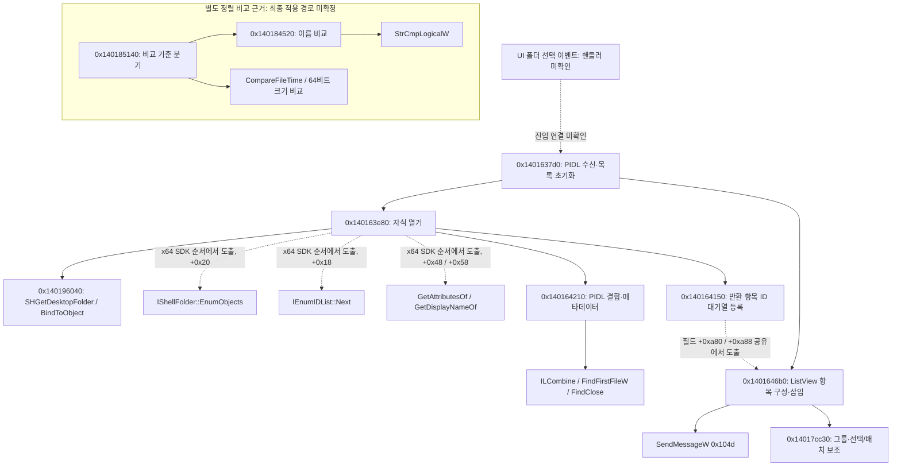

# RE-02 — 폴더 열거·목록 표시의 정적 분석

대상: Explorer++ **1.4.0.2293**, Windows x64, SHA-256 `22ac20341c5525658ebe5e9c4b9ac9f7c152b18080ff347861fac3f04d56a2d6`([manifest](target-manifest.json)). 자료는 실제 REA/Ghidra 12.1.4 출력인 [정적 bundle](evidence/phase2-static-bundle.json) **71기록, 38,872,790바이트**를 직접 재검토했다. 주소는 선호 image base `0x140000000`의 VA이며 런타임 주소가 아니다. 원본 C++ 소스는 열람하지 않았다.

폴더 PIDL을 받아 Shell 객체를 바인딩하고 자식을 열거한 뒤, 항목별 메타데이터를 보관하고 ListView에 삽입하는 정적 경로를 확보했다. UI 이벤트부터 이 경로까지의 연결, 실제 실패 안내와 최종 정렬 적용은 아직 미확인이다. 이 문서는 원본 GUI 시험 또는 Phase 2 완료를 선언하지 않는다.

## 근거 색인

아래 식별자는 모두 위 bundle의 원래 `evidence_id`이다. `procedure_pseudo_code`와 `analyze_function`의 `confidence: observed`는 **Ghidra 표현을 관찰했다는 뜻**이며, 모든 의사코드 타입·동작이 실제 실행으로 검증되었다는 뜻은 아니다. 도구 인자·provider·profile·authority·한계는 원문에 보존되어 있다.

| 참조 | 실제 REA 도구·대상 | Evidence |
|---|---|---|
| BROWSE | `procedure_pseudo_code`, `0x1401637d0` | `ev_dda9e3cd0223a56b86fb96b1bd0cda24603bfc4ebb30e7c377fb9d37211eb59a` |
| ENUM | `analyze_function`, `0x140163e80` | `ev_970afdb1e01530bd6f56243d9b23602e2e49bcb97da429a299e5735aea76d983` |
| BIND | `procedure_pseudo_code`, `0x140196040` | `ev_b5c90d2767ee7b130372791fff1943bfd5c31d22346fc9bd8629eab4851984b5` |
| META | `analyze_function`, `0x140164210` | `ev_d78530ba1c86efa71b59082a69058bbf2ed65812dc94582a0122b17ef8b4ae4d` |
| QUEUE | `procedure_pseudo_code`, `0x140164150` | `ev_5789646dfa42e9b7e7c55f126f896bf0c0bcb2c68fd829af391ad03a75fb9587` |
| MATERIALIZE | `procedure_pseudo_code`, `0x1401646b0` | `ev_512fac631346b5b0b2002630f4e7866dcc9d09e85d1b1e1028f1ce6e3da7d5e9` |
| COMPARE | `procedure_pseudo_code`, `0x140185140` | `ev_1c1de14f1975484a69e66424814c9bb7d8893e2f7f3d06286946632232ce7931` |
| NATURAL | `procedure_pseudo_code`, `0x140184520` | `ev_6d53c388db0f2309c950c6f8ae03df1cea77e16a554f01279e9f72a598427998` |
| GROUP/SELECTION | `procedure_pseudo_code`, `0x14017cc30` | `ev_0f8f55bb4e0a6a4642c3b1702ea0b408d40e95047ab851a1d1a8d0e36cd56e5c` |
| PARSE | `procedure_pseudo_code`, `0x140163000` | `ev_50ab84a04ebad94e6d070a5cb6e766d51c217f8fedd274611e0977c2966e691f` |
| BROWSE-REF | `xrefs`, `0x1401637d0` | `ev_2251f131d8da55a7a67f60bc1157152f7522fb3bfb6cecae9d319d93a866fc9b` |
| BROWSE-CALLERS | `procedure_callers`, `0x1401637d0` | `ev_5fc10eb96f7eda2603ca88973c7aba18349a2aebdef5611ae106a193e7d28a0a` |
| NAMES | `list_names` | `ev_bcf098d43636ed7566f5a1628c11403e9db45a26d563a614a0d81fea21369d00` |

## 폴더 선택 이후의 경로

실선은 의사코드의 직접 호출, 점선은 SDK 인터페이스 배치 또는 공통 필드에서 도출한 관계이다. UI 진입과 정렬의 최종 적용은 연결을 확정하지 않았다.

| 조사 항목 | 실제 정적 관찰 | 도출·추론 및 남은 범위 |
|---|---|---|
| 폴더 식별·경로 전달 | BROWSE는 `LPCITEMIDLIST param_2`를 받으며 `SHBindToParent`, `StrRetToBufW`, 사용자 메시지 `0x8037`과 `FUN_140163e80(..., param_2)`를 포함한다. PARSE는 문자열에 `SHParseDisplayName`을 적용하고 결과 PIDL을 가상 호출에 넘긴다. | 파일시스템 문자열만이 아니라 Shell PIDL을 전달하는 경로가 있다. 주소창 입력이 PARSE를 호출하는지, 그 가상 호출이 BROWSE로 이어지는지와 특수 위치 정책은 미확인이다. |
| Shell 객체 바인딩 | BIND는 `SHGetDesktopFolder` 후 PIDL 첫 항목의 `cb==0`이면 `QueryInterface`, 아니면 `BindToObject`를 호출하고 desktop 객체를 `Release`한다. | 바인딩 도우미라는 해석은 강하게 뒷받침된다. 반환 객체의 ENUM 지역 변수까지의 전달은 아래 디컴파일 한계가 있다. |
| 디렉터리 열거 | ENUM은 `SHGetPathFromIDListW`, `ILClone`, 가상 slot `+0x20`, enumerator slot `+0x18` 루프, 속성 slot `+0x48`, 이름 slot `+0x58`, `StrRetToBufW`를 포함한다. `Next` 후보의 반환값 0과 획득 수 1을 검사한다. | x64 COM vtable의 SDK 순서에 대입하면 각각 `EnumObjects`, `IEnumIDList::Next`, `GetAttributesOf`, `GetDisplayNameOf`이다. **메서드 이름은 ABI/SDK에서 도출한 것이며 런타임 호출 추적은 아니다.** 열거 flag 후보 `0x60`/`0x100e0`과 이름 flag 후보 `1`/`0x8001`의 분기가 보인다. 설정 UI와의 의미 연결은 미확인이다. |
| 메타데이터 | ENUM이 META에 부모 PIDL·자식 PIDL·이름을 전달한다. META는 `ILCombine`/`ILClone`/`ILCloneFirst`, `SHGetPathFromIDListW`, `PathIsRootW`, `FindFirstFileW`와 `WIN32_FIND_DATAW` 형태의 속성·시간·크기 복사를 포함한다. 내부 증가 ID를 반환한다. | 일반 폴더 자식 열거는 이 경로에서 Shell이 담당하며 `FindFirstFileW`는 항목별 메타데이터 조회에 사용된다. 루트 또는 조회 실패 분기에서 이름·크기 0·directory attribute `0x10`을 채우는 fallback이 보인다. 이것을 정확한 접근 거부 UX 또는 모든 Shell 항목 지원으로 해석하지 않는다. |
| 목록 갱신 | QUEUE는 ID/삽입 위치 관련 값을 `+0xa80` 대기열에 추가하고 `+0xa88`을 증가시킨다. BROWSE는 초기 목록을 비운 뒤 ENUM과 MATERIALIZE를 순서대로 호출한다. MATERIALIZE는 같은 큐를 읽고 항목 표시 자료를 구성해 `SendMessageW(...,0x104d,...)`를 호출한다. | `0x104d`는 Win32 ListView Unicode 항목 삽입 메시지에 대응한다는 SDK 해석이다. 큐 생성→소비 관계는 같은 오프셋·ID 사용에서 도출된다. 전체 UI 스레드/비동기 보장·취소·대량 목록 응답성은 실행 검증이 필요하다. |
| 정렬 | COMPARE의 기준 필드 `+0x9f0` 분기에서 case 1은 NATURAL, case 2는 `CompareFileTime`, case 3은 두 64비트 값 비교를 수행한다. NATURAL은 표시 문자열을 구성해 `StrCmpLogicalW`를 호출한다. 비교 결과 0일 때 이름 기반 fallback, `+0x9fc`에 따른 부호 반전이 보인다. | 이름·날짜·크기 비교 전략 후보가 확보되었다. 날짜 필드의 정확한 UI 열·오름/내림 설정값·폴더 우선 정책·동률 최종 순서는 원본 관찰로 확정해야 한다. **MATERIALIZE는 최종 정렬 알고리즘이 아니다.** COMPARE가 실제 열 클릭 후 어디서 적용되는지는 미확인이다. |
| 접근 실패 | BIND/ENUM에는 HRESULT 음수 분기와 COM release가 있고 ENUM은 상태값을 반환한다. META에는 조회 실패/루트 fallback이 있다. | BROWSE 의사코드는 ENUM 호출의 결과를 이용한 오류 안내를 명확히 보여 주지 않는다. 실패 전파·이전 경로 보존·대화상자/상태 메시지는 미확인이다. 이 정적 자료로 실패 무시 버그를 확정하거나 안전성을 주장하지 않는다. |

## 디컴파일·호출 그래프의 한계

ENUM 의사코드는 `local_390 = 0` 뒤 `FUN_140196040(param_2)`만 표시하고 이어 `*local_390`을 사용한다. 그러나 BIND의 실제 복원 시그니처에는 `void **param_3` 출력 인수가 있다. 호출 인수·지역 포인터 전달의 복원이 불완전한 **디컴파일 표현상의 불일치**다. 이를 실제 null 역참조로 보고하지 않는다. 정확한 출력 인수/레지스터 전달은 호출부 어셈블리와 타입을 재검토할 별도 질문이다. 다른 helper에서도 인수 생략·타입 전파 경고가 있으므로 필드 이름을 원래 클래스 정의처럼 확정하지 않는다.

ENUM의 `relationship_coverage`는 **partial**, callee 방향에 목적지 없는 호출 **6개**를 명시한다. META는 resolved-call 관점에서 **complete**이며 호출자로 `0x140163e80`, `0x140172860`을 보고한다. `complete`도 Ghidra가 해석한 정적 call reference 범위의 완전성으로, 런타임 전체 호출 그래프나 모든 가상 호출 해결을 뜻하지 않는다.

BROWSE-CALLERS 결과는 빈 배열이다. 하지만 BROWSE-REF는 `0x1402ec0a8`, `0x1403887d8`의 참조를 반환하고 NAMES는 `0x1402ec0a8`을 `ShellBrowser::vftable`로 식별한다. 따라서 **해결된 직접 call이 없다는 관찰**이며 호출자 자체가 없다는 결론이 아니다. 가상 인터페이스/객체 조정 경로와 UI 핸들러는 추가 확인 대상이다.

MATERIALIZE가 호출하는 `0x14017cc30`에는 ListView 조회·위치/상태 변경과 그룹/선택 관련 보조 처리가 보인다. 이를 일반 정렬 엔진 또는 완전한 파일 선택 이벤트 핸들러로 이름 붙이지 않는다. 정적 함수 역할에 대한 설명은 문서의 분석용 명칭이며 원래 심볼을 복원한 주장이 아니다.

## 신뢰도와 다음 검증

직접 함수 호출·상수·명시적 외부 API가 출력에 있다는 점은 관찰이다. PIDL→Shell 열거→ID/큐→항목 삽입의 역할은 해당 표현을 연결한 도출이다. 가상 slot의 메서드 이름은 SDK/ABI 도출이고, 실제 UI 이벤트 연결·정렬 적용·오류 UX는 미확인이다. 이는 완전한 RE-02 성공 또는 재구현 기능 성공의 근거가 아니다.

다음 확인은 원본 fixture의 입력 경로/더블클릭→목록·상태 변화, bulk 1,200개 완전성/응답성, 각 열 정렬·동률, 빈/없는/실제 접근 거부 경로의 동작이다. 정적 조사에서는 binder 호출 인수·가상 browse 진입·정렬 적용 dispatcher를 우선 좁힌다. 해당 실행·추가 분석을 수행한 뒤 원문 Evidence와 결과를 연결해야 한다. 관련 P0 및 7개 UI 이벤트의 잔여 질문은 [feature-map.md](feature-map.md)에 정리한다.
