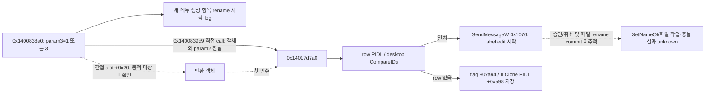

# P1 보충 실제 REA 분석

2026-10-22, 동일 Explorer++ 1.4.0.2293 SHA256 `22ac20341c5525658ebe5e9c4b9ac9f7c152b18080ff347861fac3f04d56a2d6`. 기존 session의 client 재시작으로 진행 중 호출 handle과 원장이 사라진 것을 실제 `binary_session(open:false)`로 확인한 뒤 같은 대상만 다시 열었다. 새 Ghidra 분석 7개 Evidence를 [bundle](evidence/phase5-static-bundle.json)에 저장·재파싱하고 [정확 인덱스](evidence/phase5-index.json)를 만들었다. Bundle SHA256 `ca22b54b47faaffe852ff1792d6c41159940eec6bc3bc5aaab6db0c1d3f304fe`; session은 snapshot을 저장하고 닫았다. 원본 소스 미사용.

| 질문 | 실제 관찰과 근거 | 도출·미확인 |
|---|---|---|
| Drop 위임 뒤의 동작 | `analyze_function(0x1401a5190)`, `ev_310285058c0ce8daa50f2c6faca0f50f2825c986b78c11dc5b5f699671a293c5`, bundle /records/0. mode 0은 0x1401a5340 호출, mode 1은 SHParseDisplayName→기존 binder 0x140196040→COM slot +0x40, 얻은 interface +0x18/+0x30/+0x28/+0x10 호출. Assembly 0x1401a5253은 out pointer를 R8에 넣고 0x1401a525b에서 binder를 호출한다. | 아래 바이트·SDK 교차검증으로 +0x40을 `IShellFolder::CreateViewObject`, 요청 IID를 `IDropTarget`으로 도출한다. 이어 slot은 DragEnter→Drop→DragLeave→Release에 대응한다. **정적 표현+ABI/SDK 도출**이며 실제 drop 성공/효과/등록·해제 수명주기 관찰은 아니다. mode 0의 0x1401a5340 본문은 아직 없다. 의사코드의 null 변수 표현을 실제 null 역참조 결함으로 해석하지 않는다. |
| 새 메뉴 생성 뒤 rename 시작 | 문자열 xrefs `ev_abecdf049b50525419cd881abfc4e7bf11baf6e90d6a2a11ecf5c47b246bd777`는 0x140083968 한 위치. 내부주소 0x1400838c0 분석은 포함 함수 **0x1400838a0**로 해석됨(`/records/5`, `ev_d6ad1767529c187facc939124d6ffb493741502ece24df1138b74b7b9447fcf8`). log의 전체 문자열은 'Starting in-place rename of item created via new menu'. 이 함수는 0x14017d7a0 호출. | 이름 변경 일반 경로 전체나 F2 처리로 확대하지 않는다. 시작 콜백의 조건은 param3=1/3이며 원래 enum 명칭은 불명이다. |
| 목록의 어떤 항목을 편집하는가 | `analyze_function(0x14017d7a0)`, `ev_3590de16dd81838b0547537203010b4af00ee09da2ded56601c5078d4a15bf69`, /records/1. SHBindToParent/GetDisplayNameOf, 목록 row의 PIDL과 desktop CompareIDs 비교, 일치하면 SendMessageW `0x1076`에 row 전달. Assembly 0x14017d9da는 row를 R8로, 0x14017d9dd는 `0x1076`을 EDX로 전달한다. 없으면 상태 flag와 ILClone(PIDL)을 보관. | 아래 설치 SDK의 정확한 정의에서 `LVM_EDITLABELW=0x1000+118=0x1076`으로 도출한다. 생성 PIDL에 맞는 row의 label edit을 시작하는 흐름이며 실제 rename commit은 아니다. 항목이 아직 없을 때 보관하는 상태의 후속 소비자, edit 승인/취소 notification, 실제 파일 rename/충돌 처리는 미추적이다. |
| CreateDirectoryW는 어디서 호출되는가 | callers `ev_be73202a37286603fcb7cbc6d505f2db8665444d8941e2d2af7ebbd364ae7d40`→0x140206a50. decompile `ev_d02eb737073be324983326bce97b6b69d10cc582c9adecdf88667ef7e2ff24d2`, /records/4. `boost::filesystem::create_directories`/`create_directory` 오류문자열, 자기 재귀, CreateDirectoryW와 GetLastError, 오류 결과/예외 분기가 실제 존재한다. callers `ev_f1f139d2219b76f8e4b0217c2bf95367a67567c36e4bb53c78c8868cdb17d913`는 자기 자신·0x140213270·0x1402158e0. | 라이브러리의 재귀 디렉터리 생성 wrapper는 확인했다. 사용자 New Folder 명령과 직접 연결하지 않았으므로 FR15의 원본 이벤트 경로 복원 성공이라고 세지 않는다. |

## 독립 바이트·설치 SDK 교차검증

설치 경계는 `C:\Program Files (x86)\Windows Kits\10\Include\10.0.26100.0\um\`이다. 아래 SDK는 대상 원본 소스가 아니다. GUID는 **보충 바이트 직접 관찰**이며 새 REA Evidence로 위장하지 않는다. 기존 [PE inventory](evidence/pe-inventory.json)의 format-aware RVA/file mapping과 원본 EXE의 전체 SHA-256을 다시 확인한 뒤 16 bytes만 읽었다.

| 해석 | 직접 확인한 값·위치 | 증명 범위 |
|---|---|---|
| Unicode label edit | `CommCtrl.h:177`의 `LVM_FIRST=0x1000`, `CommCtrl.h:3500`의 `LVM_EDITLABELW=(LVM_FIRST+118)` | REA의 `0x1076` 메시지 상수를 SDK 의미에 연결한다. label edit 시작과 파일시스템 rename 완료는 구별한다. |
| IID bytes | `DAT_1402ed8e0`: RVA `0x2ed8e0`, `.rdata` 파일 offset `0x2ecae0`, 16 bytes `2201000000000000c000000000000046`; little-endian GUID `00000122-0000-0000-c000-000000000046` | 원본 EXE hash가 위 manifest와 일치했다. 해당 16-byte 범위 SHA-256은 `642e3a17653930ca371c1496890516deb6b58803141f0e546b48d954010c7c8b`다. |
| IID와 slot | `OleIdl.h:3700`의 `IID_IDropTarget`, `:3704`의 같은 GUID, `:3708–3721`의 DragEnter/DragOver/DragLeave/Drop 순서 | IUnknown의 3개 method 뒤 x64 pointer slots `+0x18/+0x20/+0x28/+0x30`을 도출한다. `+0x10`은 Release다. 이 함수에서 DragOver 호출을 관찰한 것은 아니다. |
| Shell 객체의 interface 요청 | `shobjidl_core.h:4602–4605`의 `IShellFolder::CreateViewObject(hwndOwner,riid,ppv)` | 선언된 상속/메서드 순서와 x64 ABI에서 `+0x40`을 도출한다. REA assembly 0x1401a527d는 위 IID 주소를 R8, 0x1401a5279는 output pointer를 R9에 넣고 0x1401a5288에서 `+0x40`을 호출한다. |

## 새 메뉴 rename의 정확한 경계

`0x1400838c0`이라는 요청 내부 주소는 REA가 포함 함수 `0x1400838a0`로 해석했다. 이 구분을 유지한다. callback의 원래 enum/진입 slot/메뉴 command와 가상 `+0x20`의 동적 대상은 확인하지 않았으며 F2 일반 rename과 연결하지 않는다. `LVM_EDITLABELW` 이후 실제 데이터 변경과 오류 경로를 조사해야 FR-14 전체 원본 경로에 대한 주장을 할 수 있다.

새 bundle의 resolved-call coverage는 `/records/0`이 미해결 목적지 6개, `/records/1`이 4개, `/records/5`가 1개 때문에 **partial**이다. mkdir `/records/4`와 callers의 `complete`도 해석된 정적 참조 inventory 범위이며 런타임 전체 caller·성공·예외 UX의 완전성을 뜻하지 않는다. `_CxxThrowException`와 오류 분기는 실제 정적 표현에 있지만 원본 앱에서 해당 실패를 실행했다는 주장은 없다. 재귀 boost wrapper의 `CreateDirectoryW` 호출을 New Folder UI 성공으로 변환하지 않는다.

기존 copy/move wrapper의 SHFileOperationW MOVE/COPY 선택 근거는 유지한다. 새 제품은 자체 안전한 staging/no-replace/identity 계약을 추가한 **일반 API 기반 설계**이며 원본과 같은 구현이라고 하지 않는다. Qt moveToTrash를 사용하는 새 휴지통 기능은 원본 recycle API 경로가 확인되지 않아 REA 기반으로 분류하지 않는다. 세 가지 보기·clipboard·Qt DnD·오류·진행률도 관찰/API/새 설계와 REA 기여를 구분한다. 원본 delete/영구삭제·rename commit·drop 등록/회수·충돌 UI의 미확인은 [조사 후보](p1-investigation-leads.md)에 남긴다.
