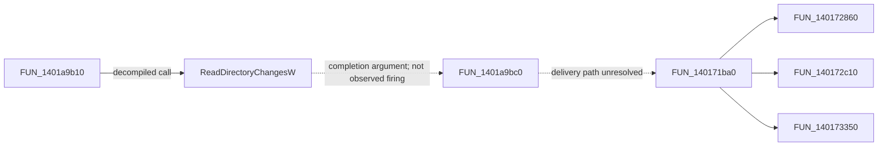

# Windows Shell integration — RE-04 static review

This report separates recovered API use from application policy and from runtime behavior. It reviews only the canonical [phase2-static-bundle.json](evidence/phase2-static-bundle.json): **71 records, 38,872,790 bytes**, SHA-256 `0fa335949accc46b85f05360ffe6b3897e6caec8f0d1ec6a26b2e59be521b08a`. The reviewed Explorer++.exe is PE x86-64, SHA-256 `22ac20341c5525658ebe5e9c4b9ac9f7c152b18080ff347861fac3f04d56a2d6`. Native evidence uses Ghidra 12.1.4 through REA.

The bundle has zero captures and zero scenarios. **No runtime result is established by this report.** Any later execution or newly acquired Evidence must be reviewed in a successor snapshot before changing these conclusions. Original Explorer++ source was not read. Ghidra pseudocode is a recovered representation, not original C++ source; its type guesses, unreachable-block warnings and unresolved indirect calls remain limitations.

## Coverage by required example

| RE-04 example | Strongest evidence in this snapshot | Conclusion and remaining gap |
|---|---|---|
| File icons | Decompiled SHGetFileInfoW calls, with system icon index / PIDL or icon / overlay flags; S1–S3 | Windows supplies icon/metadata information. Which returned image is ultimately displayed for every item is not fully traced or runtime checked. |
| File thumbnails | Imported DwmSetIconicThumbnail and names containing ShellBrowser::ThumbnailResult_t; S1 | Candidate thumbnail-related structures exist. File thumbnail acquisition/provider/caching is not recovered. DWM window/tab thumbnails must not be confused with file previews. |
| Open in default associated application | ShellExecute imports/callers, excluded special-purpose opens, PIDL execution and activation candidates; S4–S7/S16–S17 | A PIDL-based ShellExecuteExW request is decompiled. The file-list activation-to-default-app outcome is not yet runtime established. FR-09 remains partially answered here. |
| Directory change detection | ReadDirectoryChangesW call with 16,000-byte buffer and completion callback; separate directory-change update function; S8–S9 | OS notification consumption and application update logic are statically supported. Callback-to-update queue delivery, overflow recovery and observed refresh behavior remain unverified. |
| Copy / move | SHFileOperationW wrapper selects MOVE/COPY, checks abort state and handles name mappings; S10 | File transfer is delegated to Windows; list construction, option selection and result handling are application logic. UI commands and full error/collision behavior are not runtime established. |
| Drag and drop | Seven-entry ShellBrowser vtable bytes, SDK slot interpretation, three corresponding decompilations; S11–S14 | IDropTarget roles are inferred with supporting signatures/data handling. Effect selection and DropHandler delegation are recovered; end-to-end transfers and registration lifecycle remain incomplete. |
| Properties dialog | Properties-related names; S1 | A name/command-like label does not prove Windows Shell property-sheet invocation. No inspected decompilation establishes this path. |
| Recycle Bin handling | RecycleBin-related names; transfer wrapper has no DELETE selector; S1/S10 | Special-location names do not establish recycle-on-delete. Neither the delete command path nor FOF_ALLOWUNDO / IFileOperation::Delete behavior is established. |

## Icons and thumbnails

The names record imports `SHGetFileInfoW`, `SHGetImageList`, `Shell_GetImageLists`, `ImageList_GetIcon` and `DwmSetIconicThumbnail`. An import alone proves a symbol dependency, not a caller's purpose or a successful runtime result. S2 contains actual `SHGetFileInfoW(..., 0x4000)` use in FUN_140187350, and FUN_140187090 has another such call. In S3, FUN_140173350 calls with `0x148` and FUN_140172c10 with `0x140`.

The installed Windows SDK `shellapi.h` identifies `0x4000` as SHGFI_SYSICONINDEX, `0x100` as SHGFI_ICON, `0x40` as SHGFI_OVERLAYINDEX, and `0x8` as SHGFI_PIDL. Thus `0x148` requests an icon plus overlay index for a PIDL; `0x140` requests icon plus overlay index using the path form. These are derived flag interpretations, not recovered original enum names. [Microsoft documents both the flags and PIDL/path distinction](https://learn.microsoft.com/en-us/windows/win32/api/shellapi/nf-shellapi-shgetfileinfow).

S1's `std::optional<ShellBrowser::ThumbnailResult_t>` and packaged-task names are leads, not proof of a specific thumbnail worker or cancellation/cache design. [DwmSetIconicThumbnail represents a window or tab for the taskbar](https://learn.microsoft.com/en-us/windows/win32/api/dwmapi/nf-dwmapi-dwmseticonicthumbnail); its import cannot establish per-file image preview extraction.

## Default application execution: avoid false attribution

Three tempting ShellExecute call sites have narrower purposes:

- **S4, FUN_14009cea0:** obtains the current executable directory, appends `Explorer++ Help.chm`, parses its PIDL, calls ShellExecuteExW and constructs HelpFileMissingDialog on failure. This supports help-file opening, not generic selected-file activation.
- **S5, FUN_140194fd0:** obtains the current process's module filename and sets `lpVerb=L"open"`, `lpFile=local_228`, `lpParameters=param_2` before ShellExecuteExW. This is a self-launch path.
- **S6, FUN_140197ea0:** builds a `cmd.exe` path and chooses `open` or `runas` before ShellExecuteW. This is command-prompt launching.

S7's FUN_1401607f0 contains a rectangle hit test followed by `ShellExecuteW(hwnd, L"open", (LPCWSTR)(param_1+6), NULL, NULL, 5)`. The stored text is set by another message branch, but its owner and connection to the file-list selected item are not established by this snapshot. Likewise FUN_1400f69a0 explicitly opens an expanded `%windir%\\explorer.exe` path in its inspected branch. Neither is sufficient to claim FR-09 restored.

[ShellExecute's open verb is defined by Windows](https://learn.microsoft.com/en-us/windows/win32/api/shellapi/nf-shellapi-shellexecutew), but API semantics cannot fill the missing application event/data path. The current snapshot now includes **S16, FUN_1400bd5c0**. It clones the input PIDL, removes its last ID, binds to the parent, asks an indirect method at +0x58 for display data with flag 0x8000, and converts the result into a candidate working directory. Its SHELLEXECUTEINFOW has cbSize=0x70, fMask=0xC, **lpVerb=L""** (preserved exactly, not rewritten as NULL), lpFile=NULL, lpIDList=param_2 and lpParameters=param_3, followed by ShellExecuteExW. SDK shellapi.h identifies 0xC as SEE_MASK_INVOKEIDLIST, enabling context-menu based verbs. This is actual static evidence for delegated PIDL execution, stronger than an import or the excluded help/self/cmd paths. The input item's UI origin, blank-verb interpretation/default selection, error outcome and launched application remain unverified. The function does not check the API return in its recovered body.

The newly inspected **S17, FUN_1400bce20**, checks Shell item attributes, chooses internal navigation branches or an indirect +0x70 activation path, and explicitly delegates one branch to %windir%\\explorer.exe. Its empty direct-callers record (S18) does not prove it is unused; virtual dispatch remains unresolved. These facts narrow the activation question without inventing a resolved edge from S17 to S16.

## Directory notifications versus list updates

S8's FUN_1401a9b10 allocates **16,000 bytes**, stores the buffer, and calls:

```text
ReadDirectoryChangesW(*(HANDLE *)(p+0x20), buffer, 16000,
                      *(BOOL *)(p+0x25c), *(DWORD *)(p+600),
                      NULL, (LPOVERLAPPED)(p+0x28), FUN_1401a9bc0)
```

Offsets are preserved from Ghidra, without claiming a recovered class layout. The code stores the BOOL result; on zero it frees the buffer, calls CancelIo and closes the handle. The non-null OVERLAPPED/completion arguments support an asynchronous-notification interpretation. Handle opening flags, alertable wait behavior, callback body, rearming and final cleanup are not supplied by this function alone. [Microsoft's contract](https://learn.microsoft.com/en-us/windows/win32/api/winbase/nf-winbase-readdirectorychangesw) also requires recovery when notifications overflow; this snapshot does not establish that recovery.

S9's FUN_140171ba0 has “Starting directory change update”, Adding, Removing, Modifying, Old name, New name and Finished log literals, branches on event values, calls FUN_140172860 / FUN_140172c10 / FUN_140173350, and sends control messages around updates. This is stronger than import evidence for an application-side update dispatcher. The reviewed records do **not** establish a direct call edge from completion FUN_1401a9bc0 to FUN_140171ba0; that connecting queue/message/callback path remains open.



Solid arrows are recovered calls. Dashed arrows preserve incomplete linkage; the graph is not a runtime trace.

## Copy / move policy and Shell ownership

S10's FUN_1401a7630 builds a UTF-16 source list by copying each source with its terminator and adding a final terminator. It fills SHFILEOPSTRUCTW, calls SHFileOperationW, and returns success only when the API return is zero **and** `fAnyOperationsAborted==0`.

Two exact expressions matter:

```text
wFunc = ((int)param_1[8] != 0) + 1
fFlags = 0x28, or 0x20 when the tested field at byte offset 0x44 is zero
```

The installed SDK defines FO_MOVE=1, FO_COPY=2, FO_DELETE=3, FOF_RENAMEONCOLLISION=0x8, FOF_WANTMAPPINGHANDLE=0x20 and FOF_ALLOWUNDO=0x40. Therefore the boolean selector chooses **MOVE or COPY**, and the flag choices request mapping handles with optional rename-on-collision. No tested branch here chooses DELETE, and neither flag set contains ALLOWUNDO. The boolean's original field name and UI toggle semantics remain unknown.

After successful completion the function compares returned old/new name mappings, updates its result names, calls SHFreeNameMappings, invokes an indirect callback at slot `+0x18`, and cleans its temporary list. Windows owns the actual file transfer; Explorer++ owns request assembly and application result reconciliation. The [SHFILEOPSTRUCTW contract](https://learn.microsoft.com/en-us/windows/win32/api/shellapi/ns-shellapi-shfileopstructw) explains the OS fields; it does not prove UI confirmation, progress, overwrite, failure preservation, rollback or recycle behavior occurred.

## Drag and drop: observed bytes, inferred interface roles

S11 reads exactly 56 bytes at `0x1402ec068`, marked complete. Decoding seven little-endian x64 pointers yields:

| Slot | Target | Interpretation from official IDropTarget order |
|---:|---|---|
| 0 | 0x140082440 | QueryInterface candidate |
| 1 | 0x14017a570 | AddRef candidate |
| 2 | 0x14017a580 | Release candidate |
| 3 | 0x140178e80 | DragEnter candidate; S12 |
| 4 | 0x140179270 | DragOver candidate; S13 |
| 5 | 0x140179660 | DragLeave candidate; body not inspected here |
| 6 | 0x140179920 | Drop candidate; S14 |

S1 labels the table ShellBrowser::vftable; S11 also has six static xrefs to it. The installed SDK `OleIdl.h` explicitly lists IUnknown's first three methods followed by DragEnter/DragOver/DragLeave/Drop. [Microsoft describes IDropTarget's responsibilities](https://learn.microsoft.com/en-us/windows/win32/api/oleidl/nn-oleidl-idroptarget). Matching layout and argument shapes support this interface inference, but there is no runtime QueryInterface or event trace.

S12 queries a data object through indirect calls, requests format value 0xF, uses GlobalLock/DragQueryFileW, compares roots with PathIsSameRootW, and selects effect bits 0/1/2/4 subject to incoming allowed effects, key state and same-root state. S13 repeats selection and performs edge-scroll/hit-feedback work. SDK constants identify COPY=1, MOVE=2, LINK=4; its SHIFT=0x4 and CONTROL=0x8 match the tested masks. This is evidence of application policy around OS drag/drop contracts, not proof that every transfer format works.

S14 obtains a target path, handles a possible child destination, constructs DropHandler::vftable, and delegates to FUN_1401a5190, with another branch to FUN_140179ea0. The bodies of these delegated operations are absent here. RegisterDragDrop/RevokeDragDrop/DoDragDrop imports are leads only: registration ownership, revoke-on-destruction, outgoing drag behavior, transfer completion and cancellation are not established.

## Properties and recycle: explicitly unresolved

S1 contains `s_Properties_=_45015` / `u_Properties` labels and RecycleBin-related location/column names. No reviewed decompilation establishes a properties verb/COM context-menu path, or a delete operation using recycle semantics. These are bounded negative findings over this bundle's named and decompiled records, not claims that Explorer++ lacks those features. A reconstructed implementation using a documented Windows properties/recycle API would be **general API based** until the original program's actual path is supported by Evidence.

## Evidence locator ledger

The canonical JSON is physically one line, so misleading per-record line anchors are not used. Each link opens the exact hashed bundle; the JSON pointer and full Evidence ID select the record. IDs, source-byte identity and pointer are all needed when reviewing a successor export.

| Label | JSON pointer / operation | Evidence ID |
|---|---|---|
| S1 | [`/records/60`](evidence/phase2-static-bundle.json), list_names | `ev_bcf098d43636ed7566f5a1628c11403e9db45a26d563a614a0d81fea21369d00` |
| S2 | [`/records/0`](evidence/phase2-static-bundle.json), procedure_pseudo_code 0x140187350 | `ev_00f7b5c1c1047b786d6223366e6c431e3cd45a79c9e712fddea05acb7593234c` |
| S3 | [`/records/51`](evidence/phase2-static-bundle.json), procedure_pseudo_code 0x140173350; also /records/26 for 0x140172c10 | `ev_ad5bbad86afa46a4b572689342731c57a99e7187d7debd76b73c4777ab343088`; `ev_4c770e0ef421600e4990c877f3b1d379ef2c340a46be06fe60594956a558b748` |
| S4 | [`/records/16`](evidence/phase2-static-bundle.json), analyze_function 0x14009cea0 | `ev_25df43d36c41f00bcea5f2b476bbe53e3f45e185039d7c0f65789c849c471da6` |
| S5 | [`/records/13`](evidence/phase2-static-bundle.json), procedure_pseudo_code 0x140194fd0 | `ev_21a2de0620d2705ead8b4abec5731577cef68eae65d76ce4acafbee7711684c0` |
| S6 | [`/records/23`](evidence/phase2-static-bundle.json), procedure_pseudo_code 0x140197ea0 | `ev_3df3ea886e17b152b5f4d377fdce7341830778f07a8a61843e5acec57b4958da` |
| S7 | [`/records/22`](evidence/phase2-static-bundle.json), procedure_pseudo_code 0x1401607f0 | `ev_3bec0bf727e1be9dff676ab67c7deadadaea5286fa1a892e3419cbced275601e` |
| S8 | [`/records/61`](evidence/phase2-static-bundle.json), procedure_pseudo_code 0x1401a9b10 | `ev_c575f01e0e8efd6219b1f6ecd377ea9f403a63d2f9acfde0d41b3e66545e711f` |
| S9 | [`/records/10`](evidence/phase2-static-bundle.json), analyze_function 0x140171ba0 | `ev_1833fa2545dcaf1a16f796fe9e11fad0146e3cb7b969facef4aaa36ac1720255` |
| S10 | [`/records/50`](evidence/phase2-static-bundle.json), procedure_pseudo_code 0x1401a7630; /records/58 SHFileOperationW callers | `ev_a6af60e3bd61d7cca2e8d3255e23dbddbe9bcb8f3147c26c54e7dca7ae1a66e9`; `ev_b957a5780fddbffbadceb44e7c71fb93ecc8bafa17e4d97b9e57660520e24f6e` |
| S11 | [`/records/47`](evidence/phase2-static-bundle.json), read_bytes 0x1402ec068; /records/30 xrefs | `ev_9d6c8203a6f21e8874ef16abf2322c683057a24632a7f2bd42a51d0f0fc15fa9`; `ev_52f1a056a7aa68984db9128bb7135b93c4471fee26c179d08b6a19fdb20c469b` |
| S12 | [`/records/18`](evidence/phase2-static-bundle.json), procedure_pseudo_code 0x140178e80 | `ev_31296ff49e6986f663c9eec54c8e921bfe7b11f3b67dd3ac52f33412313e5a2f` |
| S13 | [`/records/62`](evidence/phase2-static-bundle.json), procedure_pseudo_code 0x140179270 | `ev_c65a9ef46e64126efcd4fd66683bad189aab555ee43b763ffbecaf61838499f4` |
| S14 | [`/records/20`](evidence/phase2-static-bundle.json), procedure_pseudo_code 0x140179920 | `ev_37033ee2017621418f12890bb629601cfcc8fa391268e48485698cbb8c59fd5b` |
| S15 | [`/records/24`](evidence/phase2-static-bundle.json), ShellExecuteExW callers; /records/57 ShellExecuteW callers | `ev_44f502515c8685c94a77584c61cbe69d3ecde42f0f2dda46c57219a7f4f7d153`; `ev_b726bd7bb142d72aa48618b1baea63ffcd879870f274719097b27aa7dc1def66` |
| S16 | [`/records/19`](evidence/phase2-static-bundle.json), procedure_pseudo_code 0x1400bd5c0 | `ev_369e8cb0f86b0a7f29c9cff2149e791629aa707c191c9780fbd8754d0783694b` |
| S17 | [`/records/70`](evidence/phase2-static-bundle.json), procedure_pseudo_code 0x1400bce20 | `ev_fc2e69129dd48e48cb15ae6d6d6d7a724a1e2e67dda942c84297943ce2bde8cf` |
| S18 | [`/records/3`](evidence/phase2-static-bundle.json), procedure_callers 0x1400bce20 | `ev_0afb9884a651186b73acb2bd3a38660209b748b156e864a36caf07579c45d7e1` |

SDK interpretation was checked against `C:\Program Files (x86)\Windows Kits\10\Include\10.0.26100.0\um\shellapi.h` lines 251–265, 393–397 and 1256–1276; `OleIdl.h` lines 3669–3675 and 3732–3779; `WinUser.h` lines 2729–2733. These official API declarations are separate from the target's source.

## Independent reviewer notes and next checks

This review re-parsed and hashed the canonical export, including the five-record successor update, selected records by exact address/operation, decoded the vtable bytes independently, and compared numeric values with SDK declarations. It did not rely on another agent's narrative as proof.

The most consequential safeguards are: help/self/cmd execution is not FR-09; 0x28/0x20 is not recycle; a thumbnail name is not a recovered preview pipeline; seven vtable slots are an IDropTarget inference, not a traced event; and callback/update functions must not be joined by an invented direct call.

Next evidence should connect the recovered 0x1400bd5c0 PIDL request to the main activation event and actual default application, the notification completion/queue and overflow path, drop delegation and registration cleanup, property-sheet invocation, and the delete/recycle path. Runtime comparisons must use a disposable test directory and separately cover read operations, transfer collisions and destructive operations. Confidence is high for the explicit API calls/constants, moderate for interface/policy role inference, and unresolved for end-to-end runtime fidelity. No RE-04 example is marked runtime verified or reimplementation complete here.

