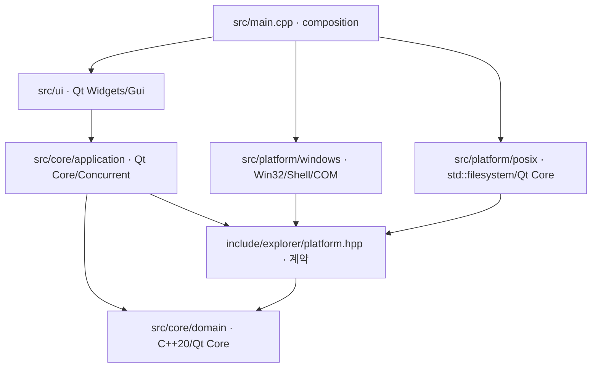

# 공통 코어와 플랫폼 경계

이 문서는 [전체 요구사항](../requirements.md)에 따른 Phase 3 설계다. 구현 시작은 상위 작업의 Phase 2 게이트 기록 이후다. 원본 C++ 소스는 사용하지 않았으며 REA 근거, 직접 관찰, 일반 API 구현과 새 제품 정책을 구별한다. GUI 결정은 [ADR-001](adr-001-gui.md), 공개 타입·메서드·실패 의미는 [interfaces.md](interfaces.md)가 소유한다.

## 모듈과 의존성

| 모듈/예정 CMake target | 소유 책임 | 금지되는 의존성 |
|---|---|---|
| `explorer_domain` | 위치·항목·오류·탭·history·정렬/필터·작업 값 타입과 순수 정책 | Widgets, Win32, PIDL, COM, 파일시스템 조회 |
| `explorer_application` | 탭 상태, 요청 세대, 비동기 작업 스케줄, 성공 시 history commit, 선택/검색/정렬, 작업 진행·결과 | UI widget 포인터, 직접 OS 호출/열거 |
| Platform Interface | 이미 파싱된 위치·메타데이터·오류·capability·작업 계약 | Windows 헤더·QtGui/Widgets 타입 |
| `explorer_platform_windows` | 문자열→Windows 위치 파싱, Shell/Win32 열거·메타데이터·identity·natural compare·OS 실행·파일 작업·아이콘 | UI/탭/history 정책 |
| `explorer_platform_posix` | Linux/macOS 경로·표준 filesystem·locale 비교·OS 실행/휴지통 가능성 | Win32 헤더/링크, Windows 경로 규칙 재사용 |
| `explorer_ui` | Win11형 구성, entry model/delegate, 키보드/마우스·DnD transport, confirmation·메시지·선택 표시 | 자체 경로 정규화, 별도 filesystem model, Win32/Shell 직접 호출 |
| composition | OS에 맞는 `shared_ptr<IPlatform>` 한 개를 만들고 application/UI 연결 | 플랫폼 선택을 domain으로 전달 |

`include/explorer/`의 공통 계약은 C++20 표준 라이브러리와 Qt Core 타입만 사용한다. Windows adapter 내부 아이콘 변환에서 QtGui가 필요하면 private 의존성으로 두며 공개 타입으로 새지 않게 한다. `#ifdef Q_OS_WIN`은 platform/composition/CMake 선택에 한정한다. Windows SDK 헤더·Shell library는 Windows target에서만 사용한다. Linux와 macOS는 같은 POSIX 구현을 공유할 수 있지만 OS 실행/휴지통 지원은 각각 실제 질의·검증한다. 파일 URL은 UI의 `QUrl::toLocalFile` 경계에서만 로컬 경로로 변환하고 HTTP URL을 파일 경로로 재해석하지 않는다.

중앙 파일 목록은 adapter의 `DirectoryListing`을 표시하는 자체 `QAbstractTableModel`이다. `QFileSystemModel`로 별도 열거를 수행하지 않는다. Sidebar도 같은 플랫폼 계약을 통해 lazy 자식을 요청한다. `QFileInfo` 등으로 UI/공통 코어가 동일 메타데이터를 재해석하지 않는다. OS 타입 이름·원시 크기·UTC 시간·identity의 소유자는 adapter, 표시 단위·현지 시간 형식의 소유자는 UI다.

## REA 근거를 사용하는 지점

Windows의 일반 폴더 열거는 [file-navigation.md](../analysis/file-navigation.md)의 BROWSE/ENUM/BIND/META 근거를 사용해 **폴더 PIDL 바인딩→`EnumObjects`→`Next`→속성/이름→항목 메타데이터**로 설계한다. `FindFirstFileW`는 이 경로에서 주 열거기가 아니라 항목별 메타데이터 조회에 사용된다는 정적 근거를 반영한다. COM 메서드 이름 일부는 vtable/SDK 배치에서 도출되었고 UI→가상 dispatch의 전체 연결은 미확인이라는 한계를 유지한다. 원본 데이터 필드 offset이나 불완전한 디컴파일 시그니처를 그대로 재현하지 않는다.

Windows adapter는 작업이 실행되는 worker thread에서 COM 초기화·객체 생성·Release·uninitialize를 한 소유 범위로 수행한다. apartment-bound interface를 다른 worker나 UI로 넘기지 않는다. `EnumObjects`의 `S_FALSE`/null enumerator는 정상 빈 결과가 될 수 있다([Microsoft 계약](https://learn.microsoft.com/en-us/windows/win32/api/shobjidl_core/nf-shobjidl_core-ishellfolder-enumobjects)). 표시 이름과 실제 filesystem 경로를 분리하며 P0에서 지원하지 않는 가상 Shell 위치는 `Unsupported`로 돌려준다. `Drives`는 별도 명시 위치이며 빈 문자열로 표현하지 않는다.

POSIX adapter의 `std::filesystem` 열거와 Qt locale 이름 비교는 **일반 API 기반 재설계**다. REA의 Windows 내부를 POSIX에서 복구했다는 주장을 하지 않는다. Windows 파일 실행은 PIDL/OS 기본 verb 위임에 관한 OPEN 근거를 활용하되, UI handler까지 복원했다는 주장과 구별한다. 미분석 history·탭·오류·선택 정책은 요구사항/관찰을 기반으로 설계한 것으로 표시한다.

정렬은 REA의 `StrCmpLogicalW`, 시간·64-bit 크기 비교·이름 fallback을 활용한다. 폴더 우선과 미확인 값·동률의 최종 정책은 새 공통 계약이며 원본과의 정확한 일치는 시험으로 별도 확인한다. [Microsoft 문서](https://learn.microsoft.com/en-us/windows/win32/api/shlwapi/nf-shlwapi-strcmplogicalw)는 OS 버전별 순서 변화 가능성을 밝히므로 결과를 파일 identity/canonical key로 사용하지 않는다.

## 상태와 수명주기

탭 하나가 committed location, history/cursor, listing, sort, search, selection, view mode, 요청 generation, pending 입력/오류를 소유한다. 탭 전환은 이 값을 교체하지 않는다. 주소 입력 원문·표시 경로·lookup 경로/키·파일 identity를 분리한다. 사용자 입력은 adapter에서 한 번만 해석하고, 후속 소비자는 그 결과를 사용한다.

새 경로·뒤/앞·상위·새로고침은 먼저 대상과 요청 세대를 예약한다. **현재 세대의 완전한 browse 성공만** listing/location/history를 함께 commit한다. 경로 해석 실패·권한 거부·부분 열거·취소는 기존 committed 목록/위치/history cursor를 보존하고 pending 원문/복구 메시지를 표시한다. 새 방문이 성공하면 현재 cursor 뒤의 forward 분기를 제거한다. back/forward는 성공 시 예약한 cursor로만 이동하고 새 history 항목을 만들지 않는다. refresh는 history를 늘리지 않는다. 실제 다른 위치로 이동한 성공에서는 검색을 비우며 refresh와 탭 전환은 검색을 보존한다. 기본 새 탭은 원본 직접 관찰과 같이 Drives(내 PC)를 열고 별도 history·검색·선택을 갖는다. 마지막 탭 닫기는 창 종료 절차를 요청한다.

각 요청은 tab ID, lane(목록/트리/아이콘), subject key, generation을 갖는다. 같은 key의 새 요청이나 탭 닫기는 이전 stop source를 취소한다. 한 탭의 다른 트리 노드 요청은 서로 무효화하지 않는다. 응답 적용 전에 살아 있는 tab, key, generation을 모두 검사한다. 늦은 성공/실패는 현재 상태를 덮어쓰지 않으며, failure의 부분 사실은 진단용으로 보존한다.

실행 pool은 앱이 소유하고 P0 worker 수를 `max(1, min(4, idealThreadCount))`로 제한한다. 탐색·기본 앱 실행의 진행/대기 요청은 합계 12개까지이며 새 동일 탭 탐색은 앞선 stop source를 취소한다. 실제 종료 전 기존 요청도 계수하므로 큐를 무제한 늘리지 않는다. 트리는 별도 2 worker·진행/대기 합계 8개 한도이며 같은 node 중복 요청을 만들지 않는다. 한도는 PoC의 자원 정책이며 측정된 최적값이나 형식 제약이 아니다. 초과는 `ResourceLimit`/트리 안내로 표시한다. P0 아이콘은 작은 자체 그림 캐시를 재사용한다. OS 아이콘 비동기 batch는 아직 구현하지 않았다. 목록은 Entry와 문자열의 기본 추정 보관량 64 MiB를 넘으면 partialPaths와 `ResourceLimit`을 반환하고 완전 목록으로 commit하지 않는다. 이 값은 복사·정렬·임시 결과까지 포함하는 전체 프로세스 메모리 상한이 아니다.

Worker는 `shared_ptr<IPlatform>`, 요청의 값 복사, `stop_token`과 자체 결과만 보유한다. `this`, QWidget, tab model의 raw pointer를 capture하지 않는다. UI thread의 `QFutureWatcher`와 **수신 QObject context를 지정한 연결**로 완료를 전달한다. 수신자가 삭제되면 연결/후속 UI 적용이 사라지고 worker는 adapter shared ownership으로 안전하게 종료한다. queued callback에서도 tab/generation 검사를 생략하지 않는다. 자세한 thread affinity와 queued delivery 규칙은 [Qt 문서](https://doc.qt.io/qt-6.8/threads-qobject.html), watcher 계약은 [공식 문서](https://doc.qt.io/qt-6.8/qfuturewatcher.html)를 따른다. future의 cancel 상태만 바꿔 작업 중단이 보장된다고 간주하지 않고 adapter의 stop checks를 사용한다.

작업 진행 콜백은 GUI를 호출하지 않고 작은 공유 상태에 최신 집계만 기록한다. UI timer가 이 상태를 읽어 표시하므로 항목별 queued event가 누적되지 않는다. 취소 불가능한 단일 OS 호출이 늦게 끝날 수 있으므로 취소 요청과 종료 완료를 구분한다. 닫힌 탭도 실제 worker 종료 전까지 task owner와 adapter의 수명이 유지된다.

파일 변경 job은 application task manager가 소유하므로 탭 전환·새 browse로 결과가 사라지지 않는다. 사용자 job 취소 또는 앱 종료에서 취소하고 항목별 결과를 정산한다. 창 종료는 새 요청 거부→read 취소→변경 job의 계속 대기/취소 선택→진행 중 OS 호출/정리 완료→최종 결과/남은 산출물 보존→`shutdownFinished` 순서다. GUI thread에서 미리 worker pool을 파괴하거나 `waitForDone`으로 무응답 대기하지 않는다. 정리 실패도 소유한 임시 산출물·원인·재시도 정보와 함께 남기며 완료/정리 성공으로 취급하지 않는다.

## 정렬·검색·선택

정렬은 폴더/탐색 가능한 directory를 항상 먼저 두고 이름·크기·수정일 primary key에만 선택 방향을 적용한다. 크기/시각이 없는 값은 0/epoch로 바꾸지 않고 뒤에 둔다. 크기/날짜 동률은 natural name 오름차순, 이후 원본 이름의 case-sensitive UTF-16 비교, 마지막 adapter entry key byte 순서로 해소한다. 이름 정렬의 natural 동률도 같은 최종 두 규칙으로 해소한다. Windows natural 비교는 `StrCmpLogicalW`, POSIX는 고정 locale 설정의 `QCollator` numeric/case-insensitive 비교를 사용하는 adapter 제공 comparator다. 두 OS 순서가 항상 같다고 주장하지 않는다. comparator는 한 sort 동안 설정이 바뀌지 않으며 I/O하지 않는다.

기본 검색은 현재 complete listing의 실제 이름에 `QString::toCaseFolded()` literal 부분문자열 매칭을 적용한다. 공백·Unicode를 보존하고 wildcard/regex로 암묵 변환하지 않는다. 빈 검색은 전체 목록이다. 원본 SearchDialog의 재귀 기본값과 다른 점은 ADR에 명시했다. 실제 검색 결과와 원본 일치율은 scope가 같은 비교를 따로 기록한다.

선택은 row index 대신 entry key를 보관한다. 정렬/보기 전환 시 유지하고 검색에서 숨겨진 선택은 작업 대상에서 제외한다. refresh 뒤에는 같은 entry key와 identity가 유지된 것만 남긴다. 파일 identity를 확인할 수 없으면 선택을 되살리거나 같은 이름의 새 파일에 작업을 이어 붙이지 않는다. 사이드바는 expansion 요청만 lazy 수행하고 자식 전체를 재귀 preload하지 않는다.

## P1 파일 작업과 안전성

FR-11~20을 설계/검증 범위에 유지한다. 단일·복수 copy/move, recycle/permanent delete, rename/mkdir, Ctrl/Shift, 내부/OS DnD, icon/list/details, 단축키, 개수/선택/진행이 대상이다. 계획·확인·실행·항목별 결과를 같은 operation 계약으로 처리한다. DnD나 clipboard가 우회 파일 작업을 직접 수행하지 않는다.

충돌은 source/destination snapshot과 함께 계획 결과에 드러낸다. 기본값은 충돌 실패/묻기이고 조용한 overwrite를 금지한다. UI에서 정확한 대상별 overwrite를 확인한 뒤에도 실행 시 identity/상태를 재검사한다. recycle 실패를 영구 삭제로 fallback하지 않는다. 영구 삭제는 정확한 항목 집합을 밝힌 별도 확인이 필요하며 지원하지 않으면 `Unsupported`다.

Copy 실패·취소는 원본을 보존한다. 임시 복사 파일은 해당 job이 exclusive 생성한 경로만 정리하며, 정리 실패는 남은 경로와 소유 사실을 report에 유지한다. Move의 cross-volume fallback은 복사·출력 commit 성공 후에만 원본 삭제를 시도한다. 삭제 실패면 ‘복사됨, 원본 유지’로 보고하고 이동 성공으로 표시하지 않는다. 항목별 성공/실패/skip/cancel/부분 산출물을 집계해 mixed outcome을 잃지 않는다.

경로는 Unicode 원문을 유지한다. Windows extended path 형식 변환은 adapter 내부에서 해당 API에 맞게 처리하고 Shell 비호환/장경로 미지원은 구체적으로 반환한다. POSIX 이름에 Windows 대소문자·separator 규칙을 적용하지 않는다. symlink/reparse point는 별도 entry kind로 식별한다. 명시적 사용자의 해당 폴더 진입은 허용할 수 있지만 자동 tree expansion·directory copy·recursive 검색은 링크를 따라가지 않는다. 링크 자체 복사 지원이 없으면 `Unsupported`이며 target을 몰래 복사하지 않는다. 미래 follow-links 정책은 실제 object identity visited set과 명시적 opt-in 없이는 추가하지 않는다.

## 검증과 단계 전달

아래는 **시험 계획**이며 실행 결과가 아니다. [요구사항 matrix](../evaluation/requirements-matrix.md)와 [실험 protocol](../evaluation/experiment-protocol.md)이 전체 상태/측정 양식을 소유한다. mock은 의미·lifecycle를 검증하고 실제 provider/OS/GUI 성공의 대체가 아니다.

| 층 | 검증 |
|---|---|
| 코어/모의 adapter | 성공/실패 history commit, forward 분기, 탭 독립성, unknown 정렬·동률, Unicode literal 검색·선택, capability/error, delayed 완료·탭 닫기·취소·shutdown·정리 실패 재시도·mixed outcomes |
| 실제 Windows adapter | Shell 열거/메타데이터·identity, 빈/대량/Unicode/장경로, 실제 없는/권한 거부, 기본 연결 앱, 안전한 수정 fixture에서 충돌/실패/원본 보존·휴지통·reparse |
| 실제 POSIX | Ubuntu build/공통 tests/adapter/가능한 GUI, symlink·permission·실제 OS open/trash capability; macOS는 코드 경계 검토 후 환경 확보 시 build/run |
| GUI | 실제 mouse/keyboard로 탭·주소/더블클릭·뒤/앞/상위·tree·열·검색·선택·3보기·DnD·작업·오류·resize·focus·dark 시각 비교 |
| 배포 | Windows executable와 Qt dependency를 패키징한 폴더에서 실제 실행·기능 smoke, build directory/개발 PATH 의존 확인 |

필수 14시나리오의 직접 판정은 다음과 같다.

| ID | 직접 증거 |
|---|---|
| T-01 빈 폴더 | 0개 complete listing, 빈 상태, 정상 back |
| T-02 1,000개 이상 | fixture 1,200개 **전체 key/name 집합** 비교와 GUI 표시/응답·진행, visible row 일부로 대체하지 않음 |
| T-03 Unicode·특수문자 | 이름 원문·선택·직접 경로·실제 파일 정보/열기 |
| T-04 없는 경로 | NotFound, 이전 committed 목록/history 유지, 복구 가능한 안내 |
| T-05 권한 거부 | 실제 거부 fixture의 PermissionDenied와 앱 생존; mock만 통과해도 실제 항목은 미검증 |
| T-06 기록 | A→B→C→뒤/앞·분기·실패·경계 disabled |
| T-07 독립 탭 | 각 위치/history/sort/search/selection 유지·close late completion |
| T-08 정렬 | 전체 이름·크기·시각 순서, unknown·동률·directory 우선, 방향 |
| T-09 검색 | 현재 폴더 literal 정답집합·Unicode·0결과·scope 명시 |
| T-10 충돌 | copy/move 단일·복수 계획/확인/실패 후 원본·대상 hash |
| T-11 외부 삭제 | 선택 뒤 외부 삭제·replaced identity에서 NotFound/Changed, refresh/작업 복구 |
| T-12 rename 실패 | 실제 충돌/권한·잠금 원인과 원래 항목 보존 |
| T-13 링크·순환 | 실제 symlink/reparse 식별·no-follow와 유한 작업; 장경로 별도 |
| T-14 종료·재실행 | active read·mutation·최종 정리 중 종료/취소, mixed outcomes·cleanup retry, 재실행과 패키지 |

성능은 동일 원본/fixture/하드웨어/관찰 조건에서 elapsed·CPU·peak process-family memory와 UI 응답을 cold/warm 구분해 측정한다. 현재 기준값·실측 결과는 없다. Windows/Qt6.8.3과 Linux/Qt6.4.2 차이를 결과에 명시한다. CMake 최소 Qt6.4/C++20, formatter/static-analysis, 외부 Qt/asset 라이선스 기록은 구현 산출물에 포함한다.

실험 A/B 범위는 동일 FR-01~20 및 같은 P2 선택 규칙·UI 목표·fixture·검증·toolchain이다. 이 문서는 REA 해석을 포함한 **B 전용 설계 입력**이므로 A에 제공하지 않는다. A는 후속 fresh context에서 공통 요구사항·순수 직접 관찰·공식 API만 제공받아 독립 설계한다. 현재 세션을 A라고 부르지 않는다. Phase 4 전달물은 이 세 문서, 정확한 계약, 근거/차이 분류, 실제 원본 관찰과 미확인 사항이며, 문서 확정만으로 P0·P1 구현이나 원본 일치·이식성·성능을 통과시키지 않는다.
